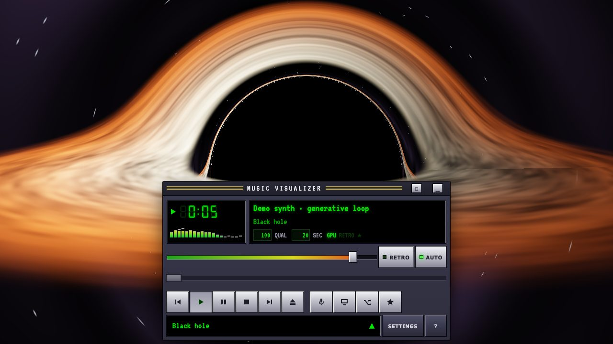
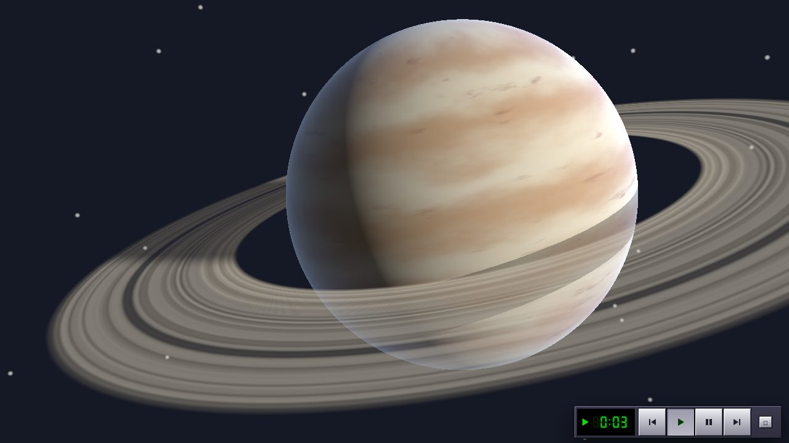
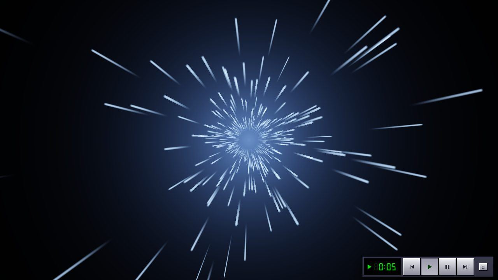
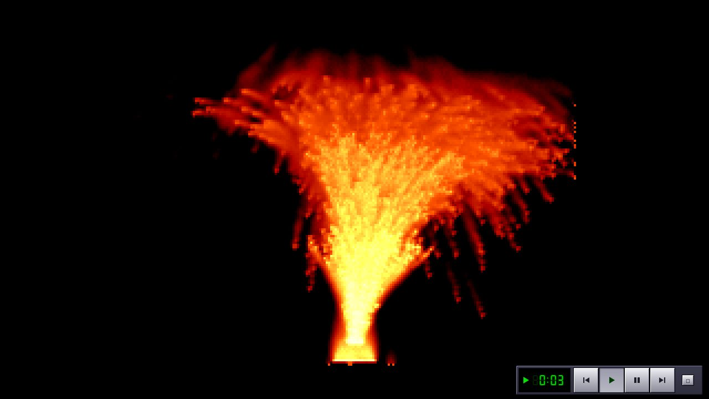
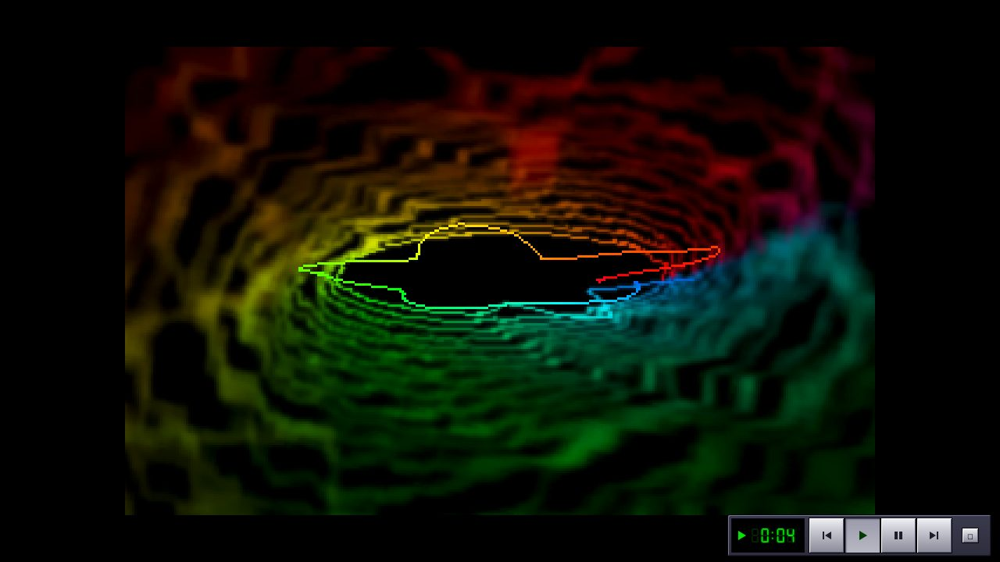
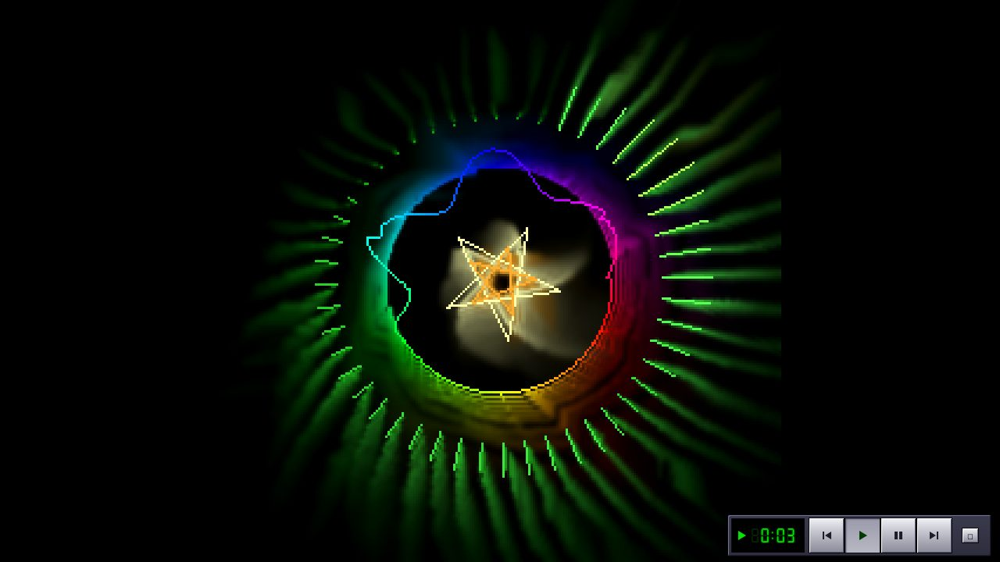
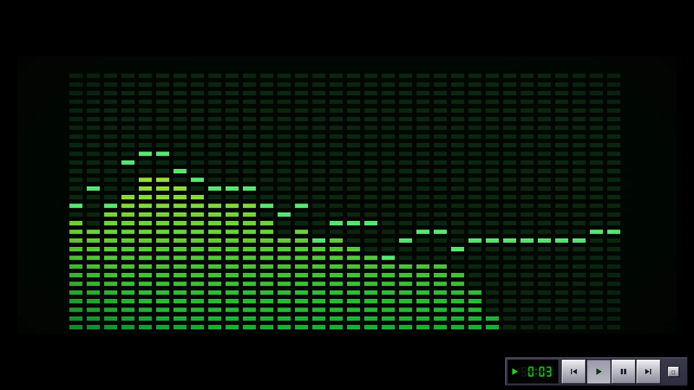

# Music Visualizer

A browser music visualizer in the spirit of 2000s media players: a classic player window with a seven-segment clock, a mini analyzer and a scrolling title, over full-screen visuals. It's a static site with no backend and no accounts. Open it, press **Play demo**, and it starts within a second.

**Live:** https://jbouder.github.io/music-visualizer/



| | |
| --- | --- |
|  |  |
|  |  |
|  |  |

## Scenes

One list of 22 scenes, plus every bundled MilkDrop preset. Press **T** (or the Retro button) to toggle the **Retro look** for whatever is playing:

- **GPU scenes** render at about 320×200, dithered to the Retro palette: a green, amber or ice-blue monochrome monitor, or 64-color VGA.
- **Canvas scenes** switch between crisp pixels (Retro on) and a smooth, glowing upscale (Retro off).

The scenes:

- **WebGL 2:**
  - Every bundled MilkDrop preset (395) via Butterchurn.
  - Eight shader scenes: Warp tunnel, Spectrum grid, Kaleidoscope bloom, Liquid blobs, Nebula drift, Black hole, Ringed planet and Hyperspace.
- **Canvas 2D:** thirteen low-resolution scenes, each taking one of four palettes (green phosphor, amber, ice blue, VGA rainbow):
  - Spectrum bars, in Normal, Fire and Line coloring.
  - Oscilloscope, with Line, Dots and Solid traces.
  - Fire, Starfield, Palette plasma and Lissajous XY.
  - Feedback effects in the style of classic player visualization studios: Scope trails, Ring scope, Dot fountain, Dot plane, Flame fountain, Ripple and Spectrogram.

Every scene works with every source: the demo synth, local files (with a queue), the microphone, or another browser tab's audio. Without WebGL 2, the app runs the canvas scenes with the Retro look locked on.

## Run it

```sh
bun install
bun run dev        # http://localhost:5173
bun run build      # static site in dist/
bun run preview    # serve dist/
```

This repo uses **bun** for installs, because npm's resolver has crashed on recent Vitest peer dependencies.

## Test it

```sh
bun run typecheck
bun run test       # Vitest: beat detector, analyzer, store, deep links, quality governor, retro helpers
```

CI runs the typecheck, the unit tests and a build on every push, then deploys `main` to GitHub Pages.

## How it works

```
Source (demo | file | mic | tab)
  ├─► master ─► speakers            (demo and file only)
  └─► vizBus ─┬─► AnalyserNode ─► AudioFrame ─┐
              └─► Butterchurn (own analysis)  │
                                              ▼
                          Engine.loop (requestAnimationFrame)
                                              │
                          activeRenderer.render(frame, dt)
```

| Path | What it is |
| --- | --- |
| `src/audio/` | `AudioEngine` (one AudioContext, master, vizBus, analyser), `analyzer.ts` (AudioFrame), `beat.ts` (pure onset detector), `sources/` |
| `src/render/` | `Engine` (one rAF loop, canvas per renderer, 400 ms crossfade, adaptive quality, context-loss recovery), `registry.ts` (lazy loaders) |
| `src/render/gl/` | `ShaderScene` runner, data textures, ping-pong feedback buffers |
| `src/render/renderers/` | `butterchurn/`, `shader/*.frag`, `retro/*.ts` |
| `src/state/` | Zustand store, persisted to localStorage through a try/catch wrapper |
| `src/app/controller.ts` | Plain-TS glue between store, audio and engine; React calls into it |
| `src/ui/` | Deck, LCD, scene picker, settings, help, `skin.css` |

The audio and render code has no React imports.

### Adding a scene

- **Shader:** add `src/render/renderers/shader/<id>.frag`, a config in `shader/index.ts`, and an entry in `registry.ts`. The runner prepends the uniforms (`uTime`, `uResolution`, `uBass`, `uMid`, `uTreble`, `uRms`, `uBeat`, `uFlash`, `uTravel`, `uFreq`, `uWave`, `uPrev`) and the helpers `freqAt(x)` and `waveAt(x)`. Multiply any beat flash by `uFlash`.
- **Retro:** extend `RetroScene` with an internal `W` and `H`, do simulation work in `step()` (fixed 30 Hz), and use `this.palette` for colors. Check `this.flashAllowed` before any strobe-like effect. For trails and feedback, draw into a `PixelBuffer` (`retro/fx.ts`): `move()` (zoom and rotate), `blur()` and `fade()`, then `line()` and `dot()`. Use `beatOnset()` to react once per beat.
